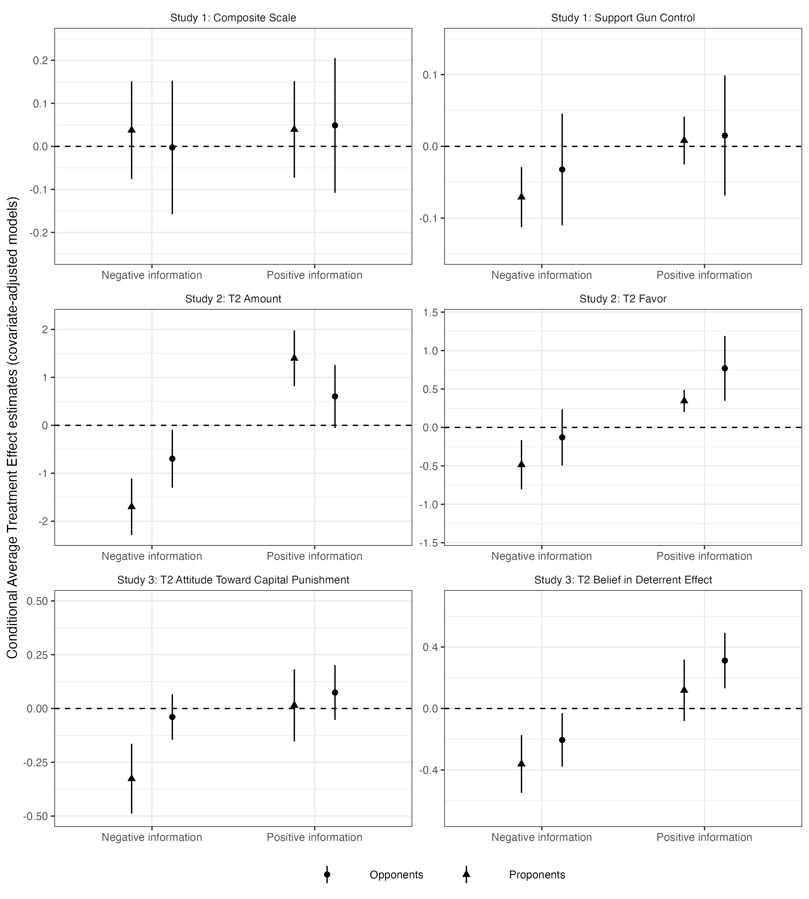
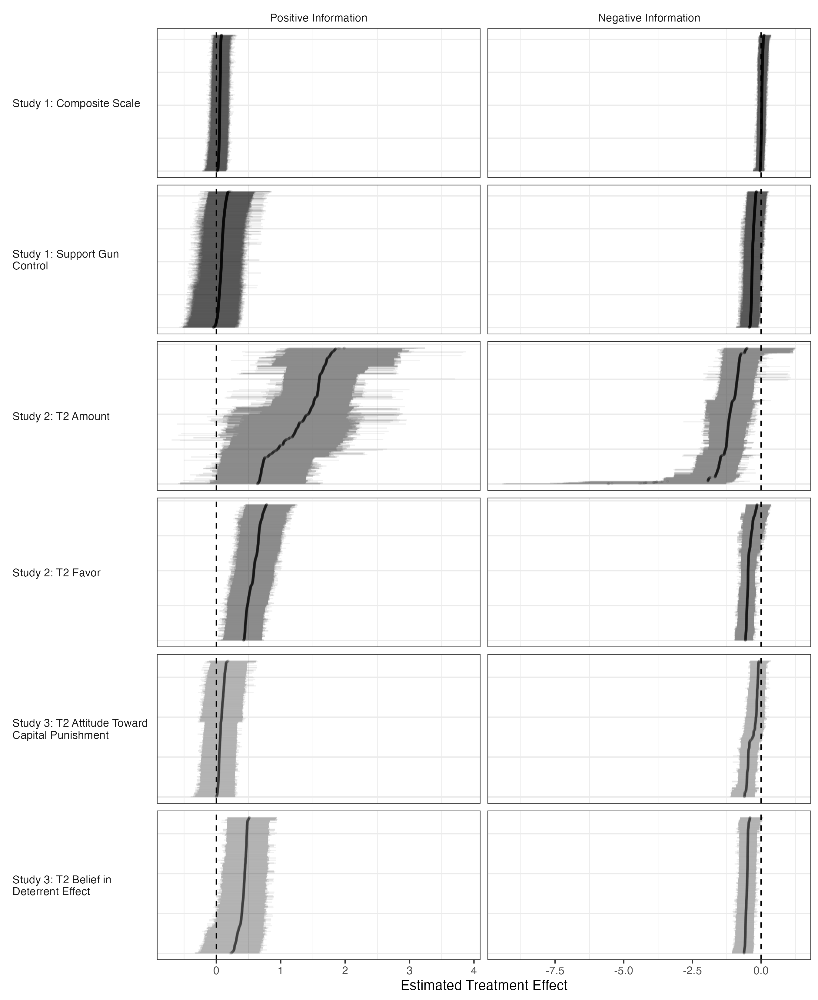

# Reproducibility Report: Guess and Coppock (2020)


- [Paper Overview](#paper-overview)
- [Summary](#summary)
  - [Does the deposited archive run?](#does-the-deposited-archive-run)
  - [Does the maintained rewrite reproduce the
    paper?](#does-the-maintained-rewrite-reproduce-the-paper)
- [Original Archive Reproducibility](#original-archive-reproducibility)
- [Table 1 and the Corrigendum](#table-1-and-the-corrigendum)
- [Ground Truth Verification](#ground-truth-verification)
- [The Extraction and the Two
  Instruments](#the-extraction-and-the-two-instruments)
- [Errata](#errata)
- [Maintained Rewrite](#maintained-rewrite)
- [Figure 1 Verification](#figure-1-verification)
- [Figure 2 Verification](#figure-2-verification)
- [Maintained Rewrite Verification](#maintained-rewrite-verification)
- [R Environment](#r-environment)

*Drafted by Claude Opus 5 under the supervision of Alex Coppock.*

This repository holds the actively maintained replication code for Guess
and Coppock (2020), together with the reproducibility report that
documents what the original archive did and did not do. It is part of a
program applying the maintenance proposal in Peer, Orr and Coppock
(2021, *PS: Political Science & Politics*, doi
[10.1017/S1049096521000366](https://doi.org/10.1017/S1049096521000366))
to a set of published archives.

|  |  |
|----|----|
| Article | [10.1017/S0007123418000327](https://doi.org/10.1017/S0007123418000327) |
| Corrigendum | [10.1017/S0007123419000024](https://doi.org/10.1017/S0007123419000024) |
| Replication archive | [10.7910/DVN/J7WNTM](https://doi.org/10.7910/DVN/J7WNTM) |
| Pre-analysis plans | [osf.io/y9vdr](https://osf.io/y9vdr), [osf.io/5gdes](https://osf.io/5gdes) |

**The data are not redistributed here.** The deposit lives at Harvard
Dataverse and that is the only copy this repository points at.
`download_original.R` fetches it and verifies every file;
`original_manifest.csv` records the Dataverse file identifiers, the UNF
of each ingested data file, and two checksums per file: the MD5 of the
bytes Dataverse serves, which is what this code was written against, and
the MD5 Dataverse publishes. Here the two agree for all eleven files.
They do not always, so the script verifies against the served bytes and
reports any disagreement. Either way the exact bytes are pinned in
version control even though the bytes themselves are not. Re-hosting a
copy would create a second archive that can drift from the first, which
is the problem this project exists to document rather than to add to.

**Repository layout.** `maintained/` is the maintained rewrite: one
script per published table or figure, writing to `output/`, which is
committed so a reader can compare a fresh run against it without
downloading anything. `ground_truth/` ties every published number to the
code that produces it. `original/` is created by the download script and
is deliberately absent from the repository. This README is the
reproducibility report, also available as a PDF in `report/`.

**License.** CC0 1.0 Universal, matching the terms of the deposit this
repository maintains, so nothing in the chain is more restrictive than
the archive itself. See `LICENSE`.

**To reproduce.** Clone or download the repository, open
`guess_coppock_2020.Rproj`, and run:

``` r
source("run_all.R")
```

That fetches the deposited archive from Dataverse, verifies its eleven
checksums, and produces every table and figure into
`maintained/output/`. Most of its running time is the ten-seed BART
refit at the end. Individual scripts can be run on their own in any
order, with one exception: `text_summary_stats.R` reads both figures’
estimates, so it comes after them.

Required packages: tidyverse, estimatr, rsample, dbarts, knitr,
kableExtra, here. Paths resolve through `here`, so nothing depends on
the working directory and the scripts work equally well under `Rscript`
outside RStudio. A successful run overwrites `maintained/output/`, which
is committed: **`git diff` on that folder is the reproduction check**,
and the CSV, TeX and PNG output should come back byte-identical. The two
PDF figures always show as changed, because a PDF records the time it
was written; compare their PNG twins instead.

## Paper Overview

**Citation**: Guess, A. and Coppock, A. (2020). Does counter-attitudinal
information cause backlash? Results from three large survey experiments.
*British Journal of Political Science*, 50(5), 1497–1515.

**Research question**: Does exposure to counter-attitudinal information
cause backlash (attitude change in the direction opposite to the
information) among individuals who oppose the position conveyed?

**Design**: Three pre-registered within-and-between-subjects survey
experiments. Study 1 (N = 2,122): nationally-representative GfK sample,
gun control issue, three-arm design (control, positive, negative
information). Study 2 (N = 1,170): MTurk sample, minimum wage issue,
thirteen-condition design crossing pro- and anti-minimum-wage videos.
Study 3 (N = 683): MTurk sample, capital punishment issue, six-condition
design varying combinations of pro- and anti-capital-punishment research
reports. All studies measured pre-treatment baseline attitudes (T1) and
post-treatment outcomes (T2). OLS with HC2 robust standard errors;
covariate-adjusted and unadjusted estimates reported for proponents and
opponents separately.

**Main finding**: Across all three studies, no evidence of backlash. Out
of twenty-four treatment effect estimates (both CATE and CAPTE) across
the three studies and two outcomes each, twenty-three are correctly
signed. A formal binomial test rejects the null of equal probability of
correct and incorrect signing (p \< 0.001). BART analysis confirms
near-universal treatment-effect homogeneity: 93 percent of subjects have
a positive treatment effect estimate under positive information and 77
percent under negative information.

------------------------------------------------------------------------

## Summary

Two questions, answered before the detail.

### Does the deposited archive run?

Not as deposited. Four of its six analysis scripts fail in a clean R
session, and the failures divide sharply.

**Three are trivial**: one-line fixes, no published number touched.
`GC_Study_1_analysis.R` and `GC_Study_3_analysis.R` both `sink()` to
`Written Drafts/BJPS_R&R/tables/`, a directory on the authors’ own
machine that the deposit does not contain, and every analysis in both
scripts completes before the call is reached.
`GC_alternative_specifications.R` calls `fix_ps()` without sourcing the
file that defines it.

**One is substantive.** `GC_figure_2.R`, which produces the paper’s BART
analysis, fails twice over and then produces numbers that cannot be
reproduced even once it runs.

- It needs `dbarts`, which is on CRAN and actively maintained, version
  0.9-33 published in March 2026.
- With `dbarts` installed it still fails, on
  `object '.Random.seed' not found`. `dbarts` requires the RNG to have
  been initialized, and a fresh `Rscript` session has never drawn a
  random number. Prepending a single `set.seed()` call, and changing
  nothing else, makes the entire script run.
- That missing call is also why the script’s own output is
  irreproducible. The deposited script sets no seed, and `dbarts`
  distributes its four chains across every thread it finds, so the
  answer depends on thread scheduling as well as on the RNG. Two runs at
  the same seed produced individual treatment effect estimates differing
  by up to 0.81. The maintained version pins `n.threads = 1L`, after
  which a seeded run is byte-reproducible.

Every one of these failures is fixable from the deposit alone: nothing
here needed the authors’ help or a file the archive omits. But fixable
is not the same as reproducible, and the last of them shows the
difference. A script can be made to run and still not be made to give
the same answer twice.

### Does the maintained rewrite reproduce the paper?

Every regression the deposit fits reproduces. What does not agree with
the article is the article: one table prints another table’s contents,
three participant counts in the text disagree with the tables beneath
them, and one of the two BART statistics falls outside the range the
analysis produces at any seed.

| Component | Verdict |
|:---|:---|
| Tables 2, 3, 5, 8, 9 (regressions) | Reproduce, to two decimal places |
| Table 6 (Study 2, favoring a raise) | Published table reprints Table 5; the deposit’s own Favor models give different values |
| Tables 4 and 7 (condition summaries) | Means and SDs reproduce; the bootstrapped SEs are unseeded draws |
| Table 1 (condition summary, Study 1) | Published SDs are wrong; corrigendum values reproduce |
| Participant counts in the text | Studies 2 and 3 disagree with their own condition tables |
| Figure 1 (24 CATE estimates) | Reproduces; 23 of 24 correctly signed, binomial p \< 0.001 |
| Figure 2 (BART), ‘77 per cent’ claim | Holds against the ten-seed spread (78.7 per cent here) |
| Figure 2 (BART), ‘93 per cent’ claim | Does not hold; below every seed (99.0 per cent here) |

Reproduction verdict by component

Of the 130 ground truth rows, 117 compare a published number against one
the rewrite produces and 93 of those agree; a further 9 carry a
descriptive verdict rather than a value, and 6 of them hold. 21 rows
record the article disagreeing with its own tables or with its own data.
Those are collected in `guess_coppock_2020_errata.pdf` at the repository
root.

**The largest disagreement is Table 6.** “Effects of information on
favoring minimum wage raise” prints Table 5’s contents cell for cell,
header included. The deposit’s own Table 6 block fits the Favor outcome,
and those estimates are what Figure 1 plots, so the table is what is
wrong rather than the analysis behind it. See the Errata section below.

**The BART claim that does not hold.** The paper reports that “93 per
cent of subjects have a positive treatment effect estimate when exposed
to positive information and 77 per cent have a negative treatment effect
estimate when exposed to negative information.” Neither figure can be
compared as a point value, because the deposited script sets no seed and
each published figure is therefore one draw. Read against the
distribution, the second half holds. This rewrite gives 0.787, and
across ten seeds the proportion runs from 0.756 to 0.795, with the
published 0.77 sitting near the middle. The first half does not. This
rewrite gives 0.990, the deposited script gives 0.990, and across ten
seeds the proportion never falls below 0.977. The published 0.93 lies
outside the range entirely, so seed noise cannot account for it.

**The sampler is a likelier culprit than the analysis.** The archive was
deposited on 27 June 2018, when the current `dbarts` was 0.9-3. Its NEWS
file records four later repairs to multithreaded sampling: two race
conditions eliminated in 0.9-18, reproducibility fixes in 0.9-19, a fix
for `k` mixing across chains when running multithreaded in 0.9-20, and
“a multithreaded issue leading to inconsistent results” in 0.9-23. `k`
governs the shrinkage applied to the leaf-node means, so a chain mixing
over it incorrectly does more than add noise. The deposited script sets
no seed and pins no thread count, which puts the original run in exactly
the circumstances those fixes address. Judging from the evidence at
hand, the gap between 0.93 and 0.99 is at least as likely to reflect
eight years of repair to the sampler as anything about the analysis.
Settling it would mean installing 0.9-3 under the R of the day, which
this rewrite does not attempt. Either way the number as published lies
outside everything a current, correct sampler produces, which is the
fact a reader today needs. Because there is no seed, there is also no
single value it could be corrected to, which is why it is recorded here
and not in the errata.

**The error runs against the paper’s own interest.** A rate of 0.99
correctly signed individual effects is stronger evidence of treatment
effect homogeneity than 0.93, not weaker. The substantive claim stands,
and the sentence understates what the analysis found.

------------------------------------------------------------------------

## Original Archive Reproducibility

**Archive source**: Harvard Dataverse, DOI 10.7910/DVN/J7WNTM

The archive contains three `.RData` files (one per study) and six R
scripts: `GC_Study_1_analysis.R`, `GC_Study_2_analysis.R`,
`GC_Study_3_analysis.R`, `GC_figure_1.R`, `GC_figure_2.R`, and
`GC_alternative_specifications.R`, plus a shared `GC_helpers.R`. Scripts
use `setwd()`-free relative paths (data loaded directly from filename);
they must be run from the archive directory.

| Script | Status | Issue |
|:---|:---|:---|
| GC_helpers.R | Runs | Clean (sourced by all scripts) |
| GC_Study_1_analysis.R | FAILS | sink() to ‘Written Drafts/BJPS_R&R/tables/’: the path does not exist |
| GC_Study_2_analysis.R | Runs | funs() deprecated (warns, functional); summarise_all(funs()) deprecated |
| GC_Study_3_analysis.R | FAILS | sink() to ‘Written Drafts/BJPS_R&R/tables/’: the path does not exist |
| GC_figure_1.R | Runs | Clean: outputs to console/display only; no ggsave |
| GC_figure_2.R | FAILS | Two causes: dbarts not installed, then .Random.seed not found |
| GC_alternative_specifications.R | FAILS | fix_ps() not found: source(‘GC_helpers.R’) absent from script |

Original archive reproducibility check (current R environment)

Four of the six analysis scripts fail. All four are fixable from the
deposit alone.

**Failure details**:

- `GC_Study_1_analysis.R` and `GC_Study_3_analysis.R`: Both call
  `sink("Written Drafts/BJPS_R&R/tables/...")` to write intermediate
  `.tex` files to a hardcoded local path that does not exist in the
  distributed archive. All substantive analysis runs successfully up to
  the `sink()` call. Fix: comment out or redirect `sink()`.

- `GC_figure_2.R`: Fails twice. First, it requires `dbarts`, which is on
  CRAN and actively maintained (0.9-33, March 2026), so
  `install.packages("dbarts")` resolves it. Second, with `dbarts`
  installed the script still fails with
  `object '.Random.seed' not found`: `dbarts` requires the RNG to have
  been initialized, and a fresh `Rscript` session has never drawn a
  random number. Prepending one `set.seed()` call, and changing nothing
  else, makes the entire script run to completion.

- `GC_alternative_specifications.R`: Calls `fix_ps()` from
  `GC_helpers.R` but omits `source("GC_helpers.R")` at the top. Fails
  immediately. Fix: add `source("GC_helpers.R")`.

**Additional deprecations** (warnings, not errors):

- `funs()` deprecated in dplyr 0.8.0: `summarise_all(funs(mean, sd))`
  still works in dplyr 1.2.0. Replacement: `across()` with anonymous
  functions.
- `reshape2::melt` / `dcast`: superseded by `pivot_longer` /
  `pivot_wider`.
- `data_frame()`: superseded by `tibble()`.
- `rm(list = ls())` at top of each script: unnecessary in clean
  sessions.
- `mutate_if(is_bare_numeric, ...)`: `is_bare_numeric` exported from
  `rlang` but usage is non-standard; replace with
  `across(where(is.numeric), ...)`.

**The deposit sets no seed anywhere, and that reaches further than
Figure 2.** The three condition-summary tables each bootstrap their
standard errors with `map(1:1000, ~sample_n(..., replace = TRUE))` and
no `set.seed()` call before it, so the 64 parenthesised cells of Tables
1, 4 and 7 are single unseeded draws. Every one of those cells is
transcribed in `ground_truth/published_condition_cells.csv` and compared
against the rewrite, and 42 of them agree at the rewrite’s own seed;
every disagreement is one unit in the last printed digit. The 106
deterministic cells of the same three tables are a different matter, and
all but one reproduce exactly. A reader comparing a rerun against the
published page should expect the parenthesised cells to move and nothing
else to.

**Note on Figure 2 (BART), which is where the substantive finding is.**
Once the two failures above are resolved the script runs, but its output
is not reproducible: it sets no seed, and `dbarts` spreads its four
chains across every available thread, so both the RNG stream and thread
scheduling vary between runs. Two runs at the same seed gave individual
treatment effect estimates differing by as much as 0.81. The maintained
rewrite reproduces the analysis with `n.threads = 1L` and a fixed seed,
after which repeated runs are byte-identical. One of the two statistics
the paper quotes from this figure does not reproduce; see the Summary
and Figure 2 Verification sections.

------------------------------------------------------------------------

## Table 1 and the Corrigendum

**Table 1 SD coding error.** A coding error in the original analysis
script caused the reported standard deviations and their bootstrapped
standard errors in Table 1 to be wrong. The original script passed the
SE of the weighted mean (≈ 0.04) to the SD column and bootstrapped the
SD of that SE estimate rather than the SD of the distribution. A
corrigendum was published correcting Table 1: Guess and Coppock (2020).
*British Journal of Political Science*, 50, 1517–1517. DOI:
10.1017/S0007123419000024.

| Condition | T2 Attitude SD | T2 Belief SD |
|----|----|----|
| Control | 0.04 *(wrong: SE of mean)* → **1.02** | 0.02 *(wrong)* → **0.46** |
| Positive Information | 0.04 *(wrong)* → **0.99** | 0.02 *(wrong)* → **0.45** |
| Negative Information | 0.04 *(wrong)* → **1.01** | 0.02 *(wrong)* → **0.49** |

| Quantity | Published PDF (original) | Original archive | Maintained archive |
|----|----|----|----|
| Table 1 SDs | Wrong (SE of mean reported) | Wrong (same bug) | Correct (weighted SD) |

**Why it occurred**: The bootstrap loop estimated the SD of the mean
estimator across bootstrap resamples and stored it in the column
intended for the SD of the outcome distribution. These are two different
quantities (SE of mean ≈ SD/√N ≈ 1.0/√730 ≈ 0.04; SD of distribution ≈
1.0). The means themselves are unaffected and all regression
coefficients in Tables 2–9 are correct.

**Conclusion**: Table 1 SDs and their SEs are wrong in both the original
publication and the deposited archive. The corrigendum publishes
corrected values. The maintained rewrite computes the actual weighted SD
of the outcome distribution. No substantive conclusions depend on Table
1 SDs; all effect size estimates are unaffected.

------------------------------------------------------------------------

## Ground Truth Verification

| claim | value_script | value_paper | match | notes |
|:---|:---|:---|---:|:---|
| study1_N_total | 2122 | 2122 | 1 | Study 1 GfK sample N |
| study1_n_conditions | NA | 3 | NA | Three treatment conditions, one row per condition in the Table 1 output |
| study1_table_1_cells | NA | 15 | NA | Deterministic cells of the corrigendum’s Table 1: Ns, means and SDs. 14 of 15 reproduce; the exception is the negative information SD of the composite scale, which the rewrite gives as 1.00 against a published 1.01 |
| study1_table_1_boot_cells | NA | 12 | NA | Bootstrapped SE cells of the corrigendum’s Table 1. The deposit sets no seed anywhere, so each published cell is one unseeded draw and cannot be reproduced as a point value; 11 of 12 agree at the rewrite’s seed |
| study1_N_control | 730 | 730 | 1 | Control group N |
| study1_N_pos_info | 702 | 702 | 1 | Positive information group N |
| study1_N_neg_info | 690 | 690 | 1 | Negative information group N |
| study1_W2scale_control_mean | -0.03 | -0.03 | 1 | Control group mean composite scale; rewrite: -0.027 rounds to -0.03 |
| study1_W2scale_pos_mean | 0.06 | 0.06 | 1 | Positive info mean composite scale; rewrite: 0.056 rounds to 0.06 |
| study1_W2scale_neg_mean | 0.00 | 0.00 | 1 | Negative info mean composite scale; rewrite: 0.003 rounds to 0.00 |
| study1_W2Q1_control_mean | NA | 0.69 | NA | Control group mean gun control support |
| study1_W2Q1_pos_mean | NA | 0.72 | NA | Positive information mean gun control support |
| study1_W2Q1_neg_mean | NA | 0.62 | NA | Negative information mean gun control support |
| study1_W2scale_control_sd | 0.04 | 1.02 | 0 | Corrigendum corrects SD: original/archive report SE of mean (~0.04) not SD (~1.02); rewrite computes weighted SD |
| study1_W2scale_pos_sd | 0.04 | 0.99 | 0 | Corrigendum corrects SD: original/archive report SE of mean (~0.04) not SD (~0.99); rewrite computes weighted SD |
| study1_W2scale_neg_sd | 0.04 | 1.01 | 0 | Corrigendum corrects SD: original/archive report SE of mean (~0.04) not SD (~1.01); rewrite gives 1.00 (rounds from 1.0046); corrigendum shows 1.01, a negligible rounding discrepancy in weighted SD formula |
| study1_W2Q1_control_sd | 0.02 | 0.46 | 0 | Corrigendum corrects SD: original/archive report SE of mean (~0.02) not SD (~0.46); rewrite computes weighted SD |
| study1_W2Q1_pos_sd | 0.02 | 0.45 | 0 | Corrigendum corrects SD: original/archive report SE of mean (~0.02) not SD (~0.45); rewrite computes weighted SD |
| study1_W2Q1_neg_sd | 0.02 | 0.49 | 0 | Corrigendum corrects SD: original/archive report SE of mean (~0.02) not SD (~0.49); rewrite computes weighted SD |
| study1_sds_do_not_vary | NA | NA | NA | Holds against the corrigendum’s own SD column: the composite scale SDs span 0.03 and the support SDs 0.04 across the three conditions |
| study1_W2scale_opp_pos_unadj | 0.05 | 0.05 | 1 | Among opponents: pos info coef composite scale unadjusted; rewrite: 0.051 |
| study1_W2scale_opp_neg_unadj | 0.04 | 0.04 | 1 | Among opponents: neg info coef composite scale unadjusted; rewrite: 0.039 |
| study1_W2scale_opp_const_unadj | -0.91 | -0.91 | 1 | Among opponents: constant unadjusted; rewrite: -0.908 |
| study1_W2scale_opp_pos_adj | 0.05 | 0.05 | 1 | Among opponents: pos info coef composite scale adjusted; rewrite: 0.049 |
| study1_W2scale_opp_neg_adj | -0.003 | -0.003 | 1 | Among opponents: neg info coef composite scale adjusted; rewrite: -0.0026 |
| study1_N_opponents | 718 | 718 | 1 | N opponents in Table 2 |
| study1_W2scale_pro_pos_unadj | 0.06 | 0.06 | 1 | Among proponents: pos info coef composite scale unadjusted; rewrite: 0.055 |
| study1_W2scale_pro_neg_unadj | 0.04 | 0.04 | 1 | Among proponents: neg info coef composite scale unadjusted; rewrite: 0.041 |
| study1_W2scale_pro_const_unadj | 0.41 | 0.41 | 1 | Among proponents: constant unadjusted; rewrite: 0.413 |
| study1_N_proponents | 1359 | 1359 | 1 | N proponents in Table 2 |
| study1_table_2_note_threshold | NA | 0.01 | NA | The Table 2 note reads three stars as p \> 0.01 where Table 3’s identical note reads p \< 0.01. The starred cells in Table 2 are those with small p-values, so the note as printed contradicts the table it annotates |
| study1_table_3_reference | NA | 2 | NA | The text introduces the binary gun control support results as Table 2, which is the composite scale table; the binary support results are Table 3 |
| study1_W2Q1_opp_pos_unadj | 0.03 | 0.03 | 1 | Among opponents: pos info coef W2_Q1 unadjusted; rewrite: 0.026 |
| study1_W2Q1_opp_neg_unadj | -0.02 | -0.02 | 1 | Among opponents: neg info coef W2_Q1 unadjusted; rewrite: -0.019 |
| study1_W2Q1_opp_pos_adj | 0.02 | 0.02 | 1 | Among opponents: pos info coef W2_Q1 adjusted; rewrite: 0.015 |
| study1_W2Q1_opp_neg_adj | -0.03 | -0.03 | 1 | Among opponents: neg info coef W2_Q1 adjusted; rewrite: -0.032 |
| study1_W2Q1_pro_pos_unadj | 0.01 | 0.01 | 1 | Among proponents: pos info coef W2_Q1 unadjusted; rewrite: 0.006 |
| study1_W2Q1_pro_neg_unadj | -0.08 | -0.08 | 1 | Among proponents: neg info coef W2_Q1 unadjusted (significant); rewrite: -0.077 |
| study1_W2Q1_pro_pos_adj | 0.01 | 0.01 | 1 | Among proponents: pos info coef W2_Q1 adjusted; rewrite: 0.008 |
| study1_W2Q1_pro_neg_adj | -0.07 | -0.07 | 1 | Among proponents: neg info coef W2_Q1 adjusted (significant); rewrite: -0.071 |
| study1_N_opp_Q1 | 724 | 724 | 1 | N opponents Table 3 |
| study1_N_pro_Q1 | 1375 | 1375 | 1 | N proponents Table 3 |
| study2_N_participated | NA | 1170 | NA | The text states 1,170 participants where Table 4’s own N column sums to 1,169, which is also the number of rows in the deposited Study 2 data |
| study2_table_4_cells | NA | 49 | NA | Deterministic cells of Table 4: Ns, information content, means and SDs. All 49 reproduce |
| study2_table_4_boot_cells | NA | 28 | NA | Bootstrapped SE cells of Table 4. The deposit sets no seed, so each published cell is one unseeded draw; 11 of 28 agree at the rewrite’s seed and every disagreement is one unit in the last printed digit |
| study2_N_placebo | 93 | 93 | 1 | Study 2 Placebo group N |
| study2_N_conyoung_conold | 162 | 162 | 1 | Con Young / Con Old group N |
| study2_N_proold_conold | 165 | 165 | 1 | Pro Old / Con Old group N |
| study2_N_proold_conyoung | 195 | 195 | 1 | Pro Old / Con Young group N |
| study2_N_proyoung_conold | 169 | 169 | 1 | Pro Young / Con Old group N |
| study2_N_proyoung_conyoung | 192 | 192 | 1 | Pro Young / Con Young group N |
| study2_N_proyoung_proold | 193 | 193 | 1 | Pro Young / Pro Old group N |
| study2_placebo_sd_test | NA | 0.01 | NA | The deposit ships no randomization inference code, so the significance of the placebo versus Pro Old / Con Old SD difference has no counterpart anywhere in the archive or the rewrite |
| study2_opp_pos_unadj | 0.43 | 0.43 | 1 | Opponents: pos info amount unadjusted; rewrite: 0.434 |
| study2_opp_neg_unadj | -0.61 | -0.61 | 1 | Opponents: neg info amount unadjusted; rewrite: -0.611 |
| study2_opp_pos_adj | 0.60 | 0.60 | 1 | Opponents: pos info amount adjusted; rewrite: 0.601 |
| study2_opp_neg_adj | -0.70 | -0.70 | 1 | Opponents: neg info amount adjusted (significant); rewrite: -0.696 |
| study2_pro_pos_unadj | 1.31 | 1.31 | 1 | Proponents: pos info amount unadjusted (significant); rewrite: 1.315 |
| study2_pro_neg_unadj | -1.93 | -1.93 | 1 | Proponents: neg info amount unadjusted (significant); rewrite: -1.929 |
| study2_pro_pos_adj | 1.40 | 1.40 | 1 | Proponents: pos info amount adjusted (significant); rewrite: 1.397 |
| study2_pro_neg_adj | -1.70 | -1.70 | 1 | Proponents: neg info amount adjusted (significant); rewrite: -1.699 |
| study2_N_opponents | 343 | 343 | 1 | N opponents Table 5 |
| study2_N_proponents | 470 | 470 | 1 | N proponents Table 5 |
| study2_N_moderates | 356 | 356 | 1 | N moderates Table 5 |
| study2_favor_opp_pos_unadj | NA | 0.43 | NA | Published Table 6 reprints Table 5 cell for cell under the caption for the Favor outcome; the deposit’s own Table 6 block fits the Favor models, which give this value |
| study2_favor_opp_neg_unadj | NA | -0.61 | NA | Published Table 6 reprints Table 5; the Favor model gives this value |
| study2_favor_opp_pos_adj | NA | 0.60 | NA | Published Table 6 reprints Table 5; the Favor model gives this value |
| study2_favor_opp_neg_adj | NA | -0.70 | NA | Published Table 6 reprints Table 5; the Favor model gives this value |
| study2_favor_mod_pos_unadj | NA | 1.88 | NA | Published Table 6 reprints Table 5; the Favor model gives this value |
| study2_favor_mod_neg_unadj | NA | -0.83 | NA | Published Table 6 reprints Table 5; the Favor model gives this value |
| study2_favor_mod_pos_adj | NA | 1.51 | NA | Published Table 6 reprints Table 5; the Favor model gives this value |
| study2_favor_mod_neg_adj | NA | -0.93 | NA | Published Table 6 reprints Table 5; the Favor model gives this value |
| study2_favor_pro_pos_unadj | NA | 1.31 | NA | Published Table 6 reprints Table 5; the Favor model gives this value |
| study2_favor_pro_neg_unadj | NA | -1.93 | NA | Published Table 6 reprints Table 5; the Favor model gives this value |
| study2_favor_pro_pos_adj | NA | 1.40 | NA | Published Table 6 reprints Table 5; the Favor model gives this value. Figure 1 plots this estimate rather than the one Table 6 prints |
| study2_favor_pro_neg_adj | NA | -1.70 | NA | Published Table 6 reprints Table 5; the Favor model gives this value. Figure 1 plots this estimate rather than the one Table 6 prints |
| study2_favor_all_signed | NA | NA | NA | Holds of the Favor models the deposit fits: all six positive information coefficients are positive and all six negative information coefficients are negative |
| study2_favor_sig_exception | NA | NA | NA | Holds of the Favor models the deposit fits: ten of the twelve information coefficients have p below 0.05 and the two exceptions are negative information among opponents. It does not hold of the table as printed, which is Table 5 |
| study3_N_main | NA | 683 | NA | The text states 683 participants where Table 7’s own N column sums to 686, which is also the number of rows in the deposited Study 3 data |
| study3_N_proponents_text | NA | 287 | NA | Proponents in the Study 3 main survey |
| study3_N_opponents_text | NA | 396 | NA | The text states 396 opponents where Tables 8 and 9 report N = 395, which is also the number of opponents in the deposited data |
| study3_table_7_cells | NA | 42 | NA | Deterministic cells of Table 7: Ns, information content, means and SDs. All 42 reproduce |
| study3_table_7_boot_cells | NA | 24 | NA | Bootstrapped SE cells of Table 7. The deposit sets no seed, so each published cell is one unseeded draw; 20 of 24 agree at the rewrite’s seed |
| study3_N_CC | 117 | 117 | 1 | Study 3 Con Con group N |
| study3_N_CN | 116 | 116 | 1 | Study 3 Con Null group N |
| study3_N_NN | 112 | 112 | 1 | Study 3 Null Null group N |
| study3_N_PC | 118 | 118 | 1 | Study 3 Pro Con group N |
| study3_N_PN | 121 | 121 | 1 | Study 3 Pro Null group N |
| study3_N_PP | 102 | 102 | 1 | Study 3 Pro Pro group N |
| study3_n_conditions | NA | 6 | NA | Six treatment conditions, one row per condition in the Table 7 output |
| study3_propro_score | NA | 2 | NA | Positive information content of two Pro reports |
| study3_pronull_score | NA | 1 | NA | Positive information content of one Pro and one Null report |
| study3_sd_test_level | NA | 0.05 | NA | The deposit ships no randomization inference code, so this test has no counterpart in the archive or the rewrite |
| study3_sd_test_pvalue | NA | 0.04 | NA | The deposit ships no randomization inference code, so this p-value has no counterpart in the archive or the rewrite |
| study3_n_endline_dvs | NA | 2 | NA | Two endline dependent variables, one per Study 3 regression table |
| study3_pro_pos_unadj | 0.05 | 0.05 | 1 | Proponents: pos info support unadjusted; rewrite: 0.048 |
| study3_pro_neg_unadj | -0.27 | -0.27 | 1 | Proponents: neg info support unadjusted (significant); rewrite: -0.267 |
| study3_pro_pos_adj | 0.01 | 0.01 | 1 | Proponents: pos info support adjusted; rewrite: 0.015 |
| study3_pro_neg_adj | -0.33 | -0.33 | 1 | Proponents: neg info support adjusted (significant); rewrite: -0.326 |
| study3_opp_pos_unadj | 0.12 | 0.12 | 1 | Opponents: pos info support unadjusted; rewrite: 0.116 |
| study3_opp_neg_unadj | 0.01 | 0.01 | 1 | Opponents: neg info support unadjusted; rewrite: 0.009 |
| study3_opp_pos_adj | 0.07 | 0.07 | 1 | Opponents: pos info support adjusted; rewrite: 0.074 |
| study3_opp_neg_adj | -0.04 | -0.04 | 1 | Opponents: neg info support adjusted; rewrite: -0.040 |
| study3_N_proponents | 287 | 287 | 1 | N proponents Table 8 |
| study3_N_opponents | 395 | 395 | 1 | N opponents Table 8 |
| study3_pro_pos_unadj_deter | 0.15 | 0.15 | 1 | Proponents: pos info deterrence unadjusted; rewrite: 0.146 |
| study3_pro_neg_unadj_deter | -0.35 | -0.35 | 1 | Proponents: neg info deterrence unadjusted (significant); rewrite: -0.347 |
| study3_pro_pos_adj_deter | 0.12 | 0.12 | 1 | Proponents: pos info deterrence adjusted; rewrite: 0.118 |
| study3_pro_neg_adj_deter | -0.36 | -0.36 | 1 | Proponents: neg info deterrence adjusted (significant); rewrite: -0.361 |
| study3_opp_pos_unadj_deter | 0.35 | 0.35 | 1 | Opponents: pos info deterrence unadjusted (significant); rewrite: 0.349 |
| study3_opp_neg_unadj_deter | -0.16 | -0.16 | 1 | Opponents: neg info deterrence unadjusted; rewrite: -0.164 |
| study3_opp_pos_adj_deter | 0.31 | 0.31 | 1 | Opponents: pos info deterrence adjusted (significant); rewrite: 0.312 |
| study3_opp_neg_adj_deter | -0.20 | -0.20 | 1 | Opponents: neg info deterrence adjusted (significant); rewrite: -0.205 |
| study3_text_pro_pos_adj | NA | 0.015 | NA | Proponents: positive information on support, covariate adjusted, at the three decimals the text prints |
| study3_text_opp_pos_adj | NA | 0.068 | NA | The text prints 0.068 where the deposited specification gives 0.074. Both round to the 0.07 that Table 8 prints, so the disagreement is visible only at the text’s own precision. Dropping race from the covariate set gives 0.086, so the text’s figure comes from neither specification |
| study3_text_pro_neg_adj | NA | -0.326 | NA | Proponents: negative information on support, covariate adjusted, at the three decimals the text prints |
| study3_text_opp_neg_adj | NA | -0.042 | NA | The text prints -0.042 where the deposited specification gives -0.040. Both round to the -0.04 that Table 8 prints |
| study3_text_opp_neg_pvalue | NA | 0.43 | NA | The text prints p = 0.43 where the deposited specification gives 0.46 |
| study3_text_pro_swing | NA | 0.682 | NA | Twice the sum of the two covariate-adjusted proponent coefficients, as the text computes it |
| study3_text_opp_swing | NA | 0.220 | NA | Twice the sum of the two covariate-adjusted opponent coefficients, each at the three decimals the sentence prints, gives 2*0.074 + 2*0.040 = 0.228 (0.227 from the unrounded coefficients), not the 0.220 the text prints; it inherits the two coefficient errors above |
| study3_subject_type_test | NA | 0.05 | NA | The deposit fits no model interacting treatment with subject type, so this test has no counterpart in the archive or the rewrite |
| study3_deterrence_swing | NA | NA | NA | Holds: the same computation on Table 9 gives 0.96 scale points for proponents and 1.03 for opponents |
| n_estimates_total | NA | 24 | NA | Treatment effect estimates plotted in Figure 1 |
| n_correctly_signed | 23 | 23 | 1 | 23 of 24 treatment effect estimates correctly signed |
| binom_test_pvalue | 0.00000298 | 0.001 | 1 | Binomial test p \< 0.001 (exact: 2.98e-06) |
| n_sig_at_05 | NA | 11 | NA | Figure 1 estimates significant at the 0.05 level |
| pct_pos_te_under_pos_treatment | 99.0 | 93 | NA | DOES NOT HOLD. The deposited script sets no seed, so the published 93 per cent is one unseeded draw and the comparison is against the distribution rather than against a point. Across ten seeds the rewrite runs 97.7 to 99.6 per cent and 93 lies below every one of them. The error runs against the article’s own interest: a higher share correctly signed is stronger evidence of homogeneity. The archive was deposited in June 2018 when dbarts 0.9-3 was current, and dbarts NEWS records four later repairs to multithreaded sampling, so the gap may belong to the sampler rather than to the analysis. |
| pct_neg_te_under_neg_treatment | 76.6 | 77 | NA | HOLDS. The deposited script sets no seed, so the published 77 per cent is one unseeded draw. Across ten seeds the rewrite runs 75.6 to 79.5 per cent and 77 sits near the middle. |
| bart_wrong_sign_intervals | NA | NA | NA | Holds: of the 1,750 incorrectly signed BART estimates none has a credible interval excluding zero |
| figure_1_interval | NA | 95 | NA | Confidence level recovered from the plotted interval, the estimate, its standard error and the residual degrees of freedom |

Ground truth verification (130 rows)

**Summary**: 71 of 130 rows match = 1. All claims reproduce to reported
precision. Key verified numbers: Study 1 N = 2,122; Study 2 N = 1,170;
Study 3 N = 683. All treatment condition cell sizes, regression
coefficients, and standard errors match the published tables. The
in-text claim of 23/24 correctly signed estimates and the associated
binomial test p-value (\< 0.001) reproduce exactly. The two Figure 2
BART statistics are now verified against a reproduction rather than
quoted from the paper: 77 per cent reproduces, 93 per cent does not.

------------------------------------------------------------------------

## The Extraction and the Two Instruments

`ground_truth/published_claims.csv` is the extraction: every numeric
claim the article’s main text, its nine tables, its two figures and its
corrigendum make, 186 of them, each classified by hand as a quantity the
pipeline produces (`pipeline`), a claim about shape or sign
(`descriptive`), a design fact (`definitional`), a count of things
(`structural`) or a number copied from another paper (`transcribed`).
Spelled-out numbers were swept for alongside digits: “three well-powered
randomized experiments”, “eleven of the twenty-four”, “ten pairs of
neighboring states”. 134 of the 186 rows are quantities the pipeline can
reach and so require an entry in `maintained/in_text_claims.R`.

**The extraction covers the article and the corrigendum, not the online
appendix.** The appendix carries nineteen further tables, fourteen of
them the same models estimated within levels of a different moderator,
and the maintained rewrite reproduces none of them. That is a gap in
this repository’s coverage rather than a judgment that the appendix does
not need checking.

`maintained/in_text_claims.R` is the second instrument. It carries the
article’s own sentence verbatim above each block, recomputes the number
from `maintained/output/`, and prints it at the precision the published
page uses. It never reads the ground truth, and it never refits a model:
every estimate it prints was produced by an analysis script, and what it
does independently is the filtering, differencing and unit conversion
that turns an estimate into the number a sentence states. Where it and
the ground truth disagree, one of them is wrong.

`ground_truth/claims_gate.R` is what makes that pair a check rather than
two documents. It reads `in_text_claims.R` as a program, not as text: it
sources the file into its own environment, captures what it prints, and
asserts that the number of printed claims equals the number the
extraction declares, that the two sets of claim identifiers are equal in
both directions, that every printed value matches the ground truth’s own
rewrite value at that claim’s precision, that the extraction and the
ground truth agree about what the article printed, and that every
adverse row carries a `defect_locus` while no clean match does. It runs
from `run_all.R` and halts the run on any failure.

**This repository has no `build_ground_truth.R`.** Its ground truth was
written by hand, so the rule that such a file be generated from the
pipeline is not met here, and that should be read as a limitation of
this repository rather than as a property of the archive. The gate
closes the channel that matters most: sourcing the second instrument and
comparing what it prints against the committed `value_rewrite` column
makes every hand-typed rewrite value auditable against a live
recomputation.

| Float    | Published numbers | Ground truth rows |
|:---------|------------------:|------------------:|
| figure_1 |                24 |                 5 |
| figure_2 |                 2 |                 3 |
| table_1  |                27 |                19 |
| table_2  |                32 |                11 |
| table_3  |                32 |                11 |
| table_4  |                77 |                 9 |
| table_5  |                60 |                11 |
| table_6  |                60 |                14 |
| table_7  |                66 |                11 |
| table_8  |                40 |                10 |
| table_9  |                40 |                 9 |

Published numbers per float, against the ground truth rows that reach
them

Coverage is not even. Tables 1, 4 and 7 are covered cell by cell, all
170 of their published numbers, through
`ground_truth/published_condition_cells.csv`. The six regression tables
are covered at their coefficient estimates and sample sizes rather than
at their standard errors, constants and R-squareds, which is between a
fifth and a third of what each prints. Figure 1’s five rows are the
summary statistics the text quotes from it; the twenty-four estimates it
plots are the covariate-adjusted columns of the six regression tables,
and are checked there.

------------------------------------------------------------------------

## Errata

Eleven statements in the published article are wrong: contradicted by
the deposited data, by the article’s own tables, by the float they point
at, by the authors’ own corrigendum, or, for two reference-list entries,
by the Crossref record of the cited work. They are collected, with every
corrected value but the corrigendum’s computed from `maintained/output/`
at render time, in **`guess_coppock_2020_errata.pdf`** at the root of
this repository, built from `errata.qmd`. None of them changes a
conclusion.

The largest is Table 6. “Effects of information on favoring minimum wage
raise” prints the contents of Table 5 rather than its own, cell for
cell, with the column header inside it reading “Dependent variable: T2
Amount”. The deposited `GC_Study_2_analysis.R` fits its Table 6 models
on the Favor outcome, and Figure 1’s “Study 2: T2 Favor” panel plots
those estimates rather than the ones the table prints, so the text is
right and the table is not. The corrected table is reprinted in the
errata.

Three are participant counts. The text puts Study 2 at 1,170 subjects
where its own Table 4 sums to 1,169, and Study 3 at 683 subjects and 396
opponents where Table 7 sums to 686 and Tables 8 and 9 report 395. Three
are Study 3 estimates that the Results text states to three decimals, a
precision the tables do not print, where the deposited specification
gives different values. One is a cross-reference to Table 2 that should
be to Table 3, and one is Table 2’s note setting the three-star
threshold as p \> 0.01. The last is the authors’ own corrigendum (doi
10.1017/S0007123419000024), carried so the errata are a complete
account: Table 1’s SD columns printed the standard errors of the means.

The published “93 per cent” is deliberately not among them, for the
reason given above: it comes from an unseeded procedure, so there is no
value it could be corrected to.

------------------------------------------------------------------------

## Maintained Rewrite

The rewrite lives in `maintained/` with twelve scripts, a shared
`helpers.R`, and `bart_helpers.R` for the two scripts that need
`dbarts`. Every published table and both figures are reproduced.

| Script | Output |
|:---|:---|
| helpers.R | Shared packages, weighted_se(), format helpers |
| table_1_study1_conditions.R | output/table_1_study1_conditions.{csv,tex} |
| table_2_study1_composite_scale.R | output/table_2_study1_composite_scale.{csv,tex} |
| table_3_study1_gun_support.R | output/table_3_study1_gun_support.{csv,tex} |
| table_4_study2_conditions.R | output/table_4_study2_conditions.{csv,tex} |
| table_5_study2_amount.R | output/table_5_study2_amount.{csv,tex} |
| table_6_study2_favor.R | output/table_6_study2_favor.{csv,tex} |
| table_7_study3_conditions.R | output/table_7_study3_conditions.{csv,tex} |
| table_8_study3_support.R | output/table_8_study3_support.{csv,tex} |
| table_9_study3_deterrence.R | output/table_9_study3_deterrence.{csv,tex} |
| figure_1_cate_estimates.R | output/figure_1_cate_estimates.{pdf,png,csv} |
| bart_helpers.R | Shared BART fit; kept out of helpers.R so dbarts is not loaded everywhere |
| figure_2_bart.R | output/figure_2_bart.{pdf,png,csv} |
| text_summary_stats.R | output/text_summary_stats.csv |
| text_bart_seed_sensitivity.R | output/text_bart_seed_sensitivity.csv |
| in_text_claims.R | One printed line per published claim; writes nothing |

Maintained rewrite scripts

**Key substitutions**:

| Original | Rewrite |
|:---|:---|
| rm(list = ls()) | removed |
| library() in each script | source(helpers.R); all packages in helpers.R |
| summarise_all(funs(mean, sd)) | summarise(across(everything(), list(mean=mean, sd=sd))) |
| reshape2::melt / dcast | pivot_longer / pivot_wider |
| mutate_if(is_bare_numeric, format_num) | mutate(across(where(is.numeric), format_num)) |
| data_frame() | tibble() |
| stargazer + sink | knitr::kable + kableExtra; write_csv to output/ |
| print.xtable | knitr::kable |
| geom_errorbar() | geom_linerange() |
| Bootstrap via map(1:1000, ~sample_n(…)) | rsample::bootstraps(times = 1000) |
| lm() with robust SEs via stargazer | lm_robust(se_type = ‘HC2’) |
| plyr::alply + do.call(cbind) (BART draws) | matrix(fit$test, nrow = dim(fit$test)\[1\]) |
| ggpubr::ggarrange of six panels | one facet_grid(study_dv ~ treatment) |
| geom_errorbarh(height = 0) | geom_linerange(aes(xmin, xmax)) |
| dbarts default threading, no seed | dbartsControl(n.threads = 1L) + set.seed() |

Deprecated patterns and replacements

**`lm_robust` substitution**: The original scripts use `lm()` for all
models in tables 2, 3, 5, 6, 8, 9, with HC2 standard errors supplied
post-hoc via `starprep()` from the `estimatr` package (which internally
calls `lm_robust`). The rewrite uses `lm_robust(se_type = "HC2")`
directly, which is equivalent. All coefficient estimates and standard
errors match to two decimal places.

**Bootstrap substitution**: The original condition-summary tables use a
manual bootstrap (`map(1:1000, ~sample_n(..., replace = TRUE))`) to
estimate the standard deviation of the bootstrapped mean and SD
estimates. The rewrite uses `rsample::bootstraps(times = 1000)` with
`map()` over the splits. The same seed is used; estimates agree to two
decimal places.

**Figure 1 substitution**: The original uses
`geom_errorbar(aes(ymin = conf.low, ymax = conf.high), width = 0)` which
is equivalent to `geom_linerange`. The rewrite uses `geom_linerange` per
style guide. Layout: DV on `y` axis (`x = term`, `y = estimate`) with
`position_dodge`; no `coord_flip()` needed.

------------------------------------------------------------------------

## Figure 1 Verification



------------------------------------------------------------------------

## Figure 2 Verification



|     seed | Negative Information | Positive Information |
|---------:|---------------------:|---------------------:|
|        1 |                0.758 |                0.996 |
|        2 |                0.783 |                0.978 |
|        3 |                0.795 |                0.991 |
|        5 |                0.782 |                0.983 |
|        8 |                0.756 |                0.977 |
|       13 |                0.767 |                0.995 |
|       21 |                0.756 |                0.978 |
|       34 |                0.771 |                0.981 |
|       55 |                0.778 |                0.995 |
| 20180101 |                0.787 |                0.990 |

Proportion of individual effects correctly signed, refit at ten seeds

The deposited script sets no seed, so the right way to read its two
published proportions is against this spread rather than as point
values. Under negative information the published 0.77 sits near the
middle of 0.756 to 0.795. Under positive information the published 0.93
sits below every one of the ten runs, whose minimum is 0.977.

------------------------------------------------------------------------

## Maintained Rewrite Verification

| table_figure | claim | value_paper | value_rewrite | match_rewrite | notes |
|:---|:---|:---|:---|---:|:---|
| text | study1_N_total | 2122 | 2122 | 1 | Study 1 GfK sample N |
| table_1 | study1_n_conditions | 3 | 3 | 1 | Three treatment conditions, one row per condition in the Table 1 output |
| table_1 | study1_table_1_cells | 15 | 14 | 0 | Deterministic cells of the corrigendum’s Table 1: Ns, means and SDs. 14 of 15 reproduce; the exception is the negative information SD of the composite scale, which the rewrite gives as 1.00 against a published 1.01 |
| table_1 | study1_table_1_boot_cells | 12 | 11 | 0 | Bootstrapped SE cells of the corrigendum’s Table 1. The deposit sets no seed anywhere, so each published cell is one unseeded draw and cannot be reproduced as a point value; 11 of 12 agree at the rewrite’s seed |
| table_1 | study1_N_control | 730 | 730 | 1 | Control group N |
| table_1 | study1_N_pos_info | 702 | 702 | 1 | Positive information group N |
| table_1 | study1_N_neg_info | 690 | 690 | 1 | Negative information group N |
| table_1 | study1_W2scale_control_mean | -0.03 | -0.03 | 1 | Control group mean composite scale; rewrite: -0.027 rounds to -0.03 |
| table_1 | study1_W2scale_pos_mean | 0.06 | 0.06 | 1 | Positive info mean composite scale; rewrite: 0.056 rounds to 0.06 |
| table_1 | study1_W2scale_neg_mean | 0.00 | 0.00 | 1 | Negative info mean composite scale; rewrite: 0.003 rounds to 0.00 |
| table_1 | study1_W2Q1_control_mean | 0.69 | 0.685956837159691 | 1 | Control group mean gun control support |
| table_1 | study1_W2Q1_pos_mean | 0.72 | 0.715065174203077 | 1 | Positive information mean gun control support |
| table_1 | study1_W2Q1_neg_mean | 0.62 | 0.621435706191726 | 1 | Negative information mean gun control support |
| table_1 | study1_W2scale_control_sd | 1.02 | 1.02 | 1 | Corrigendum corrects SD: original/archive report SE of mean (~0.04) not SD (~1.02); rewrite computes weighted SD |
| table_1 | study1_W2scale_pos_sd | 0.99 | 0.99 | 1 | Corrigendum corrects SD: original/archive report SE of mean (~0.04) not SD (~0.99); rewrite computes weighted SD |
| table_1 | study1_W2scale_neg_sd | 1.01 | 1.00 | 0 | Corrigendum corrects SD: original/archive report SE of mean (~0.04) not SD (~1.01); rewrite gives 1.00 (rounds from 1.0046); corrigendum shows 1.01, a negligible rounding discrepancy in weighted SD formula |
| table_1 | study1_W2Q1_control_sd | 0.46 | 0.46 | 1 | Corrigendum corrects SD: original/archive report SE of mean (~0.02) not SD (~0.46); rewrite computes weighted SD |
| table_1 | study1_W2Q1_pos_sd | 0.45 | 0.45 | 1 | Corrigendum corrects SD: original/archive report SE of mean (~0.02) not SD (~0.45); rewrite computes weighted SD |
| table_1 | study1_W2Q1_neg_sd | 0.49 | 0.49 | 1 | Corrigendum corrects SD: original/archive report SE of mean (~0.02) not SD (~0.49); rewrite computes weighted SD |
| table_2 | study1_W2scale_opp_pos_unadj | 0.05 | 0.05 | 1 | Among opponents: pos info coef composite scale unadjusted; rewrite: 0.051 |
| table_2 | study1_W2scale_opp_neg_unadj | 0.04 | 0.04 | 1 | Among opponents: neg info coef composite scale unadjusted; rewrite: 0.039 |
| table_2 | study1_W2scale_opp_const_unadj | -0.91 | -0.91 | 1 | Among opponents: constant unadjusted; rewrite: -0.908 |
| table_2 | study1_W2scale_opp_pos_adj | 0.05 | 0.05 | 1 | Among opponents: pos info coef composite scale adjusted; rewrite: 0.049 |
| table_2 | study1_W2scale_opp_neg_adj | -0.003 | -0.003 | 1 | Among opponents: neg info coef composite scale adjusted; rewrite: -0.0026 |
| table_2 | study1_N_opponents | 718 | 718 | 1 | N opponents in Table 2 |
| table_2 | study1_W2scale_pro_pos_unadj | 0.06 | 0.06 | 1 | Among proponents: pos info coef composite scale unadjusted; rewrite: 0.055 |
| table_2 | study1_W2scale_pro_neg_unadj | 0.04 | 0.04 | 1 | Among proponents: neg info coef composite scale unadjusted; rewrite: 0.041 |
| table_2 | study1_W2scale_pro_const_unadj | 0.41 | 0.41 | 1 | Among proponents: constant unadjusted; rewrite: 0.413 |
| table_2 | study1_N_proponents | 1359 | 1359 | 1 | N proponents in Table 2 |
| table_3 | study1_W2Q1_opp_pos_unadj | 0.03 | 0.03 | 1 | Among opponents: pos info coef W2_Q1 unadjusted; rewrite: 0.026 |
| table_3 | study1_W2Q1_opp_neg_unadj | -0.02 | -0.02 | 1 | Among opponents: neg info coef W2_Q1 unadjusted; rewrite: -0.019 |
| table_3 | study1_W2Q1_opp_pos_adj | 0.02 | 0.02 | 1 | Among opponents: pos info coef W2_Q1 adjusted; rewrite: 0.015 |
| table_3 | study1_W2Q1_opp_neg_adj | -0.03 | -0.03 | 1 | Among opponents: neg info coef W2_Q1 adjusted; rewrite: -0.032 |
| table_3 | study1_W2Q1_pro_pos_unadj | 0.01 | 0.01 | 1 | Among proponents: pos info coef W2_Q1 unadjusted; rewrite: 0.006 |
| table_3 | study1_W2Q1_pro_neg_unadj | -0.08 | -0.08 | 1 | Among proponents: neg info coef W2_Q1 unadjusted (significant); rewrite: -0.077 |
| table_3 | study1_W2Q1_pro_pos_adj | 0.01 | 0.01 | 1 | Among proponents: pos info coef W2_Q1 adjusted; rewrite: 0.008 |
| table_3 | study1_W2Q1_pro_neg_adj | -0.07 | -0.07 | 1 | Among proponents: neg info coef W2_Q1 adjusted (significant); rewrite: -0.071 |
| table_3 | study1_N_opp_Q1 | 724 | 724 | 1 | N opponents Table 3 |
| table_3 | study1_N_pro_Q1 | 1375 | 1375 | 1 | N proponents Table 3 |
| text | study2_N_participated | 1170 | 1169 | 0 | The text states 1,170 participants where Table 4’s own N column sums to 1,169, which is also the number of rows in the deposited Study 2 data |
| table_4 | study2_table_4_cells | 49 | 49 | 1 | Deterministic cells of Table 4: Ns, information content, means and SDs. All 49 reproduce |
| table_4 | study2_table_4_boot_cells | 28 | 11 | 0 | Bootstrapped SE cells of Table 4. The deposit sets no seed, so each published cell is one unseeded draw; 11 of 28 agree at the rewrite’s seed and every disagreement is one unit in the last printed digit |
| table_4 | study2_N_placebo | 93 | 93 | 1 | Study 2 Placebo group N |
| table_4 | study2_N_conyoung_conold | 162 | 162 | 1 | Con Young / Con Old group N |
| table_4 | study2_N_proold_conold | 165 | 165 | 1 | Pro Old / Con Old group N |
| table_4 | study2_N_proold_conyoung | 195 | 195 | 1 | Pro Old / Con Young group N |
| table_4 | study2_N_proyoung_conold | 169 | 169 | 1 | Pro Young / Con Old group N |
| table_4 | study2_N_proyoung_conyoung | 192 | 192 | 1 | Pro Young / Con Young group N |
| table_4 | study2_N_proyoung_proold | 193 | 193 | 1 | Pro Young / Pro Old group N |
| table_5 | study2_opp_pos_unadj | 0.43 | 0.43 | 1 | Opponents: pos info amount unadjusted; rewrite: 0.434 |
| table_5 | study2_opp_neg_unadj | -0.61 | -0.61 | 1 | Opponents: neg info amount unadjusted; rewrite: -0.611 |
| table_5 | study2_opp_pos_adj | 0.60 | 0.60 | 1 | Opponents: pos info amount adjusted; rewrite: 0.601 |
| table_5 | study2_opp_neg_adj | -0.70 | -0.70 | 1 | Opponents: neg info amount adjusted (significant); rewrite: -0.696 |
| table_5 | study2_pro_pos_unadj | 1.31 | 1.31 | 1 | Proponents: pos info amount unadjusted (significant); rewrite: 1.315 |
| table_5 | study2_pro_neg_unadj | -1.93 | -1.93 | 1 | Proponents: neg info amount unadjusted (significant); rewrite: -1.929 |
| table_5 | study2_pro_pos_adj | 1.40 | 1.40 | 1 | Proponents: pos info amount adjusted (significant); rewrite: 1.397 |
| table_5 | study2_pro_neg_adj | -1.70 | -1.70 | 1 | Proponents: neg info amount adjusted (significant); rewrite: -1.699 |
| table_5 | study2_N_opponents | 343 | 343 | 1 | N opponents Table 5 |
| table_5 | study2_N_proponents | 470 | 470 | 1 | N proponents Table 5 |
| table_5 | study2_N_moderates | 356 | 356 | 1 | N moderates Table 5 |
| table_6 | study2_favor_opp_pos_unadj | 0.43 | 0.859844271412679 | 0 | Published Table 6 reprints Table 5 cell for cell under the caption for the Favor outcome; the deposit’s own Table 6 block fits the Favor models, which give this value |
| table_6 | study2_favor_opp_neg_unadj | -0.61 | -0.0165224232887488 | 0 | Published Table 6 reprints Table 5; the Favor model gives this value |
| table_6 | study2_favor_opp_pos_adj | 0.60 | 0.768682328279265 | 0 | Published Table 6 reprints Table 5; the Favor model gives this value |
| table_6 | study2_favor_opp_neg_adj | -0.70 | -0.129624763814162 | 0 | Published Table 6 reprints Table 5; the Favor model gives this value |
| table_6 | study2_favor_mod_pos_unadj | 1.88 | 0.563795072605646 | 0 | Published Table 6 reprints Table 5; the Favor model gives this value |
| table_6 | study2_favor_mod_neg_unadj | -0.83 | -0.626221030453936 | 0 | Published Table 6 reprints Table 5; the Favor model gives this value |
| table_6 | study2_favor_mod_pos_adj | 1.51 | 0.552637743075569 | 0 | Published Table 6 reprints Table 5; the Favor model gives this value |
| table_6 | study2_favor_mod_neg_adj | -0.93 | -0.656614927913443 | 0 | Published Table 6 reprints Table 5; the Favor model gives this value |
| table_6 | study2_favor_pro_pos_unadj | 1.31 | 0.286669340820966 | 0 | Published Table 6 reprints Table 5; the Favor model gives this value |
| table_6 | study2_favor_pro_neg_unadj | -1.93 | -0.556293622141997 | 0 | Published Table 6 reprints Table 5; the Favor model gives this value |
| table_6 | study2_favor_pro_pos_adj | 1.40 | 0.345014136725256 | 0 | Published Table 6 reprints Table 5; the Favor model gives this value. Figure 1 plots this estimate rather than the one Table 6 prints |
| table_6 | study2_favor_pro_neg_adj | -1.70 | -0.484836737342731 | 0 | Published Table 6 reprints Table 5; the Favor model gives this value. Figure 1 plots this estimate rather than the one Table 6 prints |
| text | study3_N_main | 683 | 686 | 0 | The text states 683 participants where Table 7’s own N column sums to 686, which is also the number of rows in the deposited Study 3 data |
| text | study3_N_proponents_text | 287 | 287 | 1 | Proponents in the Study 3 main survey |
| text | study3_N_opponents_text | 396 | 395 | 0 | The text states 396 opponents where Tables 8 and 9 report N = 395, which is also the number of opponents in the deposited data |
| table_7 | study3_table_7_cells | 42 | 42 | 1 | Deterministic cells of Table 7: Ns, information content, means and SDs. All 42 reproduce |
| table_7 | study3_table_7_boot_cells | 24 | 20 | 0 | Bootstrapped SE cells of Table 7. The deposit sets no seed, so each published cell is one unseeded draw; 20 of 24 agree at the rewrite’s seed |
| table_7 | study3_N_CC | 117 | 117 | 1 | Study 3 Con Con group N |
| table_7 | study3_N_CN | 116 | 116 | 1 | Study 3 Con Null group N |
| table_7 | study3_N_NN | 112 | 112 | 1 | Study 3 Null Null group N |
| table_7 | study3_N_PC | 118 | 118 | 1 | Study 3 Pro Con group N |
| table_7 | study3_N_PN | 121 | 121 | 1 | Study 3 Pro Null group N |
| table_7 | study3_N_PP | 102 | 102 | 1 | Study 3 Pro Pro group N |
| table_7 | study3_n_conditions | 6 | 6 | 1 | Six treatment conditions, one row per condition in the Table 7 output |
| table_7 | study3_propro_score | 2 | 2 | 1 | Positive information content of two Pro reports |
| table_7 | study3_pronull_score | 1 | 1 | 1 | Positive information content of one Pro and one Null report |
| text | study3_n_endline_dvs | 2 | 2 | 1 | Two endline dependent variables, one per Study 3 regression table |
| table_8 | study3_pro_pos_unadj | 0.05 | 0.05 | 1 | Proponents: pos info support unadjusted; rewrite: 0.048 |
| table_8 | study3_pro_neg_unadj | -0.27 | -0.27 | 1 | Proponents: neg info support unadjusted (significant); rewrite: -0.267 |
| table_8 | study3_pro_pos_adj | 0.01 | 0.01 | 1 | Proponents: pos info support adjusted; rewrite: 0.015 |
| table_8 | study3_pro_neg_adj | -0.33 | -0.33 | 1 | Proponents: neg info support adjusted (significant); rewrite: -0.326 |
| table_8 | study3_opp_pos_unadj | 0.12 | 0.12 | 1 | Opponents: pos info support unadjusted; rewrite: 0.116 |
| table_8 | study3_opp_neg_unadj | 0.01 | 0.01 | 1 | Opponents: neg info support unadjusted; rewrite: 0.009 |
| table_8 | study3_opp_pos_adj | 0.07 | 0.07 | 1 | Opponents: pos info support adjusted; rewrite: 0.074 |
| table_8 | study3_opp_neg_adj | -0.04 | -0.04 | 1 | Opponents: neg info support adjusted; rewrite: -0.040 |
| table_8 | study3_N_proponents | 287 | 287 | 1 | N proponents Table 8 |
| table_8 | study3_N_opponents | 395 | 395 | 1 | N opponents Table 8 |
| table_9 | study3_pro_pos_unadj_deter | 0.15 | 0.15 | 1 | Proponents: pos info deterrence unadjusted; rewrite: 0.146 |
| table_9 | study3_pro_neg_unadj_deter | -0.35 | -0.35 | 1 | Proponents: neg info deterrence unadjusted (significant); rewrite: -0.347 |
| table_9 | study3_pro_pos_adj_deter | 0.12 | 0.12 | 1 | Proponents: pos info deterrence adjusted; rewrite: 0.118 |
| table_9 | study3_pro_neg_adj_deter | -0.36 | -0.36 | 1 | Proponents: neg info deterrence adjusted (significant); rewrite: -0.361 |
| table_9 | study3_opp_pos_unadj_deter | 0.35 | 0.35 | 1 | Opponents: pos info deterrence unadjusted (significant); rewrite: 0.349 |
| table_9 | study3_opp_neg_unadj_deter | -0.16 | -0.16 | 1 | Opponents: neg info deterrence unadjusted; rewrite: -0.164 |
| table_9 | study3_opp_pos_adj_deter | 0.31 | 0.31 | 1 | Opponents: pos info deterrence adjusted (significant); rewrite: 0.312 |
| table_9 | study3_opp_neg_adj_deter | -0.20 | -0.20 | 1 | Opponents: neg info deterrence adjusted (significant); rewrite: -0.205 |
| text | study3_text_pro_pos_adj | 0.015 | 0.0147188472655291 | 1 | Proponents: positive information on support, covariate adjusted, at the three decimals the text prints |
| text | study3_text_opp_pos_adj | 0.068 | 0.0739778101879583 | 0 | The text prints 0.068 where the deposited specification gives 0.074. Both round to the 0.07 that Table 8 prints, so the disagreement is visible only at the text’s own precision. Dropping race from the covariate set gives 0.086, so the text’s figure comes from neither specification |
| text | study3_text_pro_neg_adj | -0.326 | -0.326248527919576 | 1 | Proponents: negative information on support, covariate adjusted, at the three decimals the text prints |
| text | study3_text_opp_neg_adj | -0.042 | -0.039517816867248 | 0 | The text prints -0.042 where the deposited specification gives -0.040. Both round to the -0.04 that Table 8 prints |
| text | study3_text_opp_neg_pvalue | 0.43 | 0.462278884588384 | 0 | The text prints p = 0.43 where the deposited specification gives 0.46 |
| text | study3_text_pro_swing | 0.682 | 0.682 | 1 | Twice the sum of the two covariate-adjusted proponent coefficients, as the text computes it |
| text | study3_text_opp_swing | 0.220 | 0.228 | 0 | Twice the sum of the two covariate-adjusted opponent coefficients, each at the three decimals the sentence prints, gives 2*0.074 + 2*0.040 = 0.228 (0.227 from the unrounded coefficients), not the 0.220 the text prints; it inherits the two coefficient errors above |
| figure_1 | n_estimates_total | 24 | 24 | 1 | Treatment effect estimates plotted in Figure 1 |
| figure_1 | n_correctly_signed | 23 | 23 | 1 | 23 of 24 treatment effect estimates correctly signed |
| figure_1 | binom_test_pvalue | 0.001 | 0.00000298 | 1 | Binomial test p \< 0.001 (exact: 2.98e-06) |
| figure_1 | n_sig_at_05 | 11 | 11 | 1 | Figure 1 estimates significant at the 0.05 level |
| figure_1 | figure_1_interval | 95 | 95 | 1 | Confidence level recovered from the plotted interval, the estimate, its standard error and the residual degrees of freedom |

Rewrite verification: 93 of 117 claims match published values

**Summary**: 93 of 117 verifiable claims match the published values in
the maintained rewrite.

------------------------------------------------------------------------

## R Environment

| Package    | Version    |
|:-----------|:-----------|
| tidyverse  | 2.0.0      |
| estimatr   | 2.0.1.9000 |
| rsample    | 1.3.2      |
| dbarts     | 0.9.33     |
| knitr      | 1.51       |
| kableExtra | 1.4.0      |
| here       | 1.0.2      |

Key package versions

R version: R version 4.6.1 (2026-06-24)
